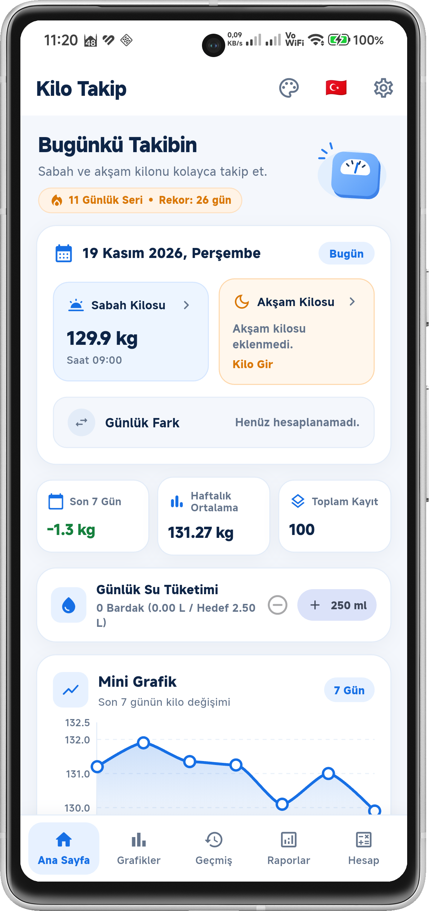
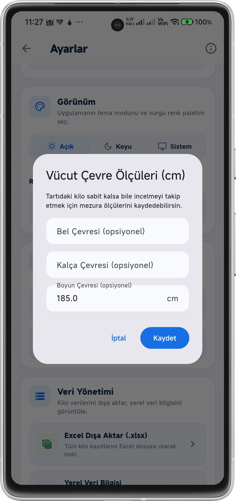
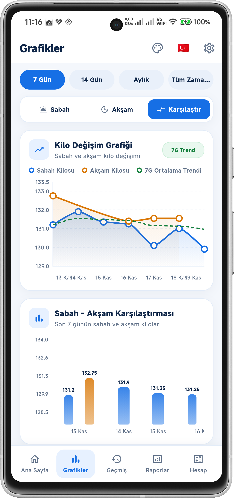

# ⚖️ Kilo & Bel Takip (FitTrack Pro)

<p align="center">
  
</p>

<p align="center">
  <b>Kişisel hedeflerinize ulaşmanız için geliştirilmiş; modern, %100 çevrimdışı, gizlilik odaklı ve eksiksiz kilo, bel çevresi ve vücut analizi takip platformu.</b>
</p>

<p align="center">
  <a href="https://github.com/mehmet-karataslar/kiloTakip/releases/latest"></a>
  <a href="https://flutter.dev"></a>
  <a href="https://dart.dev"></a>
  <a href="#"></a>
  <a href="#"></a>
  <a href="#"></a>
  <a href="#"></a>
  <a href="#"></a>
</p>

---

## 🚀 Hızlı İndir & Kur (APK)

Uygulamanın hazır derlenmiş en güncel Android APK dosyasını doğrudan indirip kullanabilirsiniz:

👉 **[📥 Kilo & Bel Takip v1.0.0 APK İndir (GitHub Releases)](https://github.com/mehmet-karataslar/kiloTakip/releases/latest/download/app-release.apk)**

> *Not: İndirdikten sonra telefonunuzda "Bilinmeyen kaynaklardan yükle" iznini onaylayarak kurulumu saniyeler içinde tamamlayabilirsiniz.*

---

## 🎬 Sosyal Medya & Reels Video Senaryosu (Tanıtım Kılavuzu)

Bu proje sosyal medyada (Instagram Reels, TikTok, YouTube Shorts) tanıtılmak üzere hazır kurgulanmıştır. Videonuzu çekerken aşağıdaki sahne akışını birebir uygulayabilirsiniz:

```text
⏱️ 00:00 - 00:03 [Kanca / Hook]: 
"Tartıda kilonuz aynı kalıyor diye pes mi ediyorsunuz? Aslında yağ yakıyor olabilirsiniz!"
(Görsel: Telefon elde, uygulama ana ekranı gösterilir).

⏱️ 00:03 - 00:10 [Problem & Çözüm]:
"Sadece kilo yetmez; gerçek değişimi bel ölçüsü gösterir. İşte hem kilo hem bel çevrenizi sabah/akşam takip eden yeni nesil uygulama!"
(Görsel: 01_dashboard.png -> 02_kilo_bel_ekle.png).

⏱️ 00:10 - 00:20 [Detaylı Ölçüm & Kolaylık]:
"Sabah aç karnına veya akşam tartınızı tek tıkla kaydedin. +0.1 veya +0.5 kg hızlı butonları, bel ölçüsü ve su sayacıyla saniyeler içinde gününüzü tamamlayın!"
(Görsel: Hızlı su ekleme ve tartı kaydı animasyonu).

⏱️ 00:20 - 00:32 [Bilimsel Analizler & Grafikler]:
"US Navy formülüyle vücut yağ oranı, VKİ, BMR, TDEE kalori ihtiyacı ve makrolarınız hazır! Üstelik sabah ve akşam kilonuzu yan yana kıyaslayan çift sütunlu grafikler."
(Görsel: 03_grafikler.png ve 06_hesap_analiz.png).

⏱️ 00:32 - 00:42 [Tasarım & Gizlilik Gücü]:
"Göz yormayan 8 farklı uyumlu renk paketi, koyu tema, 16 uluslararası dil ve sıfır internet bağımlılığı! Tüm veriler sadece sizin telefonunuzda saklanır, asla sunucuya gitmez."
(Görsel: 07_gorunum_tema.png ve 08_dil_secimi.png hızla geçiş yapar).

⏱️ 00:42 - 00:50 [Harekete Geçirici Çağrı / CTA]:
"Verilerinizi tek tıkla Excel'e aktarın, hedefinize sağlıkla ulaşın. APK linki bio'da ve GitHub'da, hemen ücretsiz deneyin!"
```

---

## 📸 Ekran Görüntüleri Sırası ve Galeri

Aşağıdaki ekran görüntüleri uygulamanın baştan sona kullanıcı deneyimini temsil etmektedir:

| 01. Gösterge Paneli | 02. Kilo & Bel Ekleme | 03. Grafikler & Kıyas |
|:---:|:---:|:---:|
|  |  |  |
| *Günlük tartı, bel farkı, su sayacı, streak ve 7 günlük sparkline* | *Sabah/akşam, hassas kg/cm seçimi, duygu etiketleri ve not alanı* | *Trend eğrisi ve sabah-akşam ölçümlerini yan yana kıyaslayan grafik* |

| 04. Geçmiş & Takvim | 05. Hedef & Raporlar | 06. Hesap & Analizler |
|:---:|:---:|:---:|
|  |  |  |
| *Kronolojik ölçüm listesi, bel rozetleri, takvim görünümü ve düzenleme* | *Kalan kilo halkası, haftalık/aylık tempo ve etiket analizleri* | *VKİ, US Navy yağ oranı, BMR, TDEE ve makro besin planlayıcı* |

| 07. Görünüm & Temalar | 08. Çoklu Dil Desteği | 09. Ayarlar & Yedekleme |
|:---:|:---:|:---:|
|  |  |  |
| *8 uyumlu renk paleti (Zümrüt, Gece Mavisi, Turuncu...) ve Koyu Mod* | *16 uluslararası dil desteği, ülke bayrakları ve anında değişim* | *Sabah/akşam tartı bildirimleri ve tek tıkla Excel (.xlsx) ihracı* |

---

## 💎 Neden Bu Uygulama? (Temel Özellikler)

### 1. ⚖️ Çift Zamanlı Kilo ve Bel Takibi (Sabah & Akşam)
* İnsan vücudu gün içerisinde tükettiği su, sodyum ve besinlere bağlı olarak 1-2.5 kg arasında dalgalanır.
* Uygulama, **Sabah** (aç karnına ve en doğru metabolik kilo) ile **Akşam** (gün sonu ağırlığı) ölçümlerini birbirinden ayırır.
* **Bel Ölçümü Entegrasyonu:** Kas kazanıp yağ yaktığınız dönemlerde kilonuz sabit kalabilir. Bel çevrenizdeki incelmeyi takip ederek motivasyonunuzu kaybetmezsiniz.

### 2. 💧 Entegre Su Takip Sayacı
* Günlük hidrasyon seviyenizi zahmetsizce kaydedin.
* +250 ml (bardak) ve +500 ml (şişe) hızlı butonları ile her su içtiğinizde tek dokunuşla ekleyin.
* Dairesel su ilerleme halkasıyla günlük hedefinize ne kadar yaklaştığınızı görün.

### 3. 📊 İnteraktif Grafik Motoru & Karşılaştırmalı Analiz
* **fl_chart** kütüphanesiyle güçlendirilmiş yumuşak geçişli eğri grafikleri.
* **Çift Sütunlu Bar Grafik:** Sabah tartınızı ve akşam tartınızı gün gün yan yana koyarak vücudunuzun günlük ödem döngüsünü görselleştirir.
* **Esnek Filtreler:** 7 Günlük, 30 Günlük, 90 Günlük, 1 Yıllık veya Tüm Zamanlar görünümü.

### 4. 🧠 Bilimsel Sağlık & Vücut Analiz Laboratuvarı
* **VKİ (Vücut Kitle İndeksi):** DSÖ (Dünya Sağlık Örgütü) aralıklarıyla kilonuzun kategorisini belirleyin.
* **İdeal Kilo Hesaplama:** Hamwi, Devine ve Robinson formülleriyle kemik ve boy yapınıza en uygun ağırlık aralığı.
* **Vücut Yağ Oranı (US Navy Formülü):** Pahalı akıllı tartılara ihtiyaç duymadan, sadece boy, boyun, bel ve kalça mezura ölçüleriyle gerçekçi yağ yüzdesi hesaplaması.
* **BMR & TDEE (Kalori İhtiyacı):** Harris-Benedict & Mifflin-St Jeor denklemleriyle dinlenme durumunda harcanan enerji ve aktivite seviyenize göre yakılan kalori.
* **Makro Besin Dağılımı:** Kilo verme, koruma veya kas kazanma hedefinize göre günlük kaç gram Protein, Karbonhidrat ve Sağlıklı Yağ almanız gerektiği.
* **Hedef Projeksiyon Simülatörü:** Güncel gidişatınıza göre hedef kilonuza hangi tarihte ulaşacağınızı öngörür.

### 5. 🎨 8 Özenle Seçilmiş Renk Paleti & Koyu Mod
Göz sağlığınızı ve estetik deneyiminizi en üst seviyede tutmak için birbiriyle tam kontrast uyumlu 8 renk paleti:
1. 🌿 **Zümrüt Yeşili (Emerald):** Doğal, ferah ve tazeleyici yeşil tonları.
2. 🌌 **Gece Yarısı Mavisi (Midnight Blue):** Derin lacivert ve odaklanmayı artıran koyu mavi.
3. 🌊 **Okyanus Ferahlığı (Ocean Teal):** Dingin ve modern turkuaz-yeşil uyumu.
4. 🌅 **Gün Batımı Turuncusu (Sunset Orange):** Enerjik, motive edici sıcak tonlar.
5. 🔘 **Antrasit & Çelik (Anthracite):** Minimalist, sade ve şık gri-siyah tonları.
6. 🌳 **Orman Yeşili (Forest Green):** Sağlığı ve sporu temsil eden koyu yeşil tonlar.
7. 💎 **Safir & Kobalt (Cobalt Sapphire):** Profesyonel ve asil mavi palet.
8. 🍁 **Sonbahar & Bakır (Autumn Amber):** Sıcak, yumuşak kahve-bakır kontrastları.
* **Koyu Mod (Dark / AMOLED):** Gece tartılmalarında gözünüzü almayan tam siyah arayüz.

### 6. 🌍 16 Uluslararası Dil Desteği
Uygulama dilini cihazınızdan bağımsız olarak anında değiştirebilirsiniz:
* 🇹🇷 Türkçe, 🇬🇧 English, 🇩🇪 Deutsch, 🇪🇸 Español, 🇫🇷 Français, 🇮🇹 Italiano, 🇷🇺 Русский, 🇸🇦 العربية, 🇨🇳 中文, 🇯🇵 日本語, 🇰🇷 한국어, 🇮🇳 हिन्दी, 🇵🇹 Português, 🇳🇱 Nederlands, 🇵🇱 Polski, 🇺🇦 Українська.

### 7. 🔒 %100 Çevrimdışı Gizlilik & Excel İhracı
* **Sıfır Bulut Bağımlılığı:** Verileriniz asla yabancı bir sunucuya gitmez, internetiniz olmasa dahi kusursuz çalışır.
* **SQLite Veritabanı:** Tüm tartı, bel ve su geçmişiniz cihazınızın güvenli yerel belleğinde saklanır.
* **Excel (.xlsx) Dışa Aktarma:** Diyetisyeninizle veya doktorunuzla paylaşmak için tüm geçmişi tek dokunuşla biçimlendirilmiş bir Excel tablosu olarak indirin.
* **Akıllı Bildirimler:** Sabah ve akşam tartılmayı unutmamanız için kişiselleştirilebilir yerel hatırlatıcılar.

---

## 📱 Ekran Görüntüsü Dosyaları Kılavuzu

Kendi telefonunuzdan ekran görüntüsü alıp projeye eklemek isterseniz, dosyaları aşağıdaki isimlerle `docs/screenshots/` klasörüne kaydetmeniz yeterlidir:

| Dosya Adı | Hangi Ekrandan Alınmalı? |
|:---|:---|
| `docs/screenshots/01_dashboard.png` | **Ana Sayfa:** Günlük kilo, fark kartı, su sayacı ve mini grafik açıkken. |
| `docs/screenshots/02_kilo_bel_ekle.png` | **Kilo Ekleme Modalı:** Alttaki (+) butonuna basıldığında açılan pencere. |
| `docs/screenshots/03_grafikler.png` | **Grafikler Sekmesi:** Çizgi ve sabah-akşam sütun grafiklerinin bulunduğu ekran. |
| `docs/screenshots/04_gecmis.png` | **Geçmiş Sekmesi:** Tarih sırasıyla dizilmiş ölçüm kartları ve bel etiketleri. |
| `docs/screenshots/05_raporlar.png` | **Raporlar Sekmesi:** Dairesel hedef ilerleme halkası ve haftalık istatistikler. |
| `docs/screenshots/06_hesap_analiz.png` | **Hesap Sekmesi:** VKİ, yağ oranı, BMR ve makro besin kartları. |
| `docs/screenshots/07_gorunum_tema.png` | **Tema Menüsü:** Üstteki tema butonuna basılınca açılan 8 renk paleti listesi. |
| `docs/screenshots/08_dil_secimi.png` | **Dil Menüsü:** Üstteki dünya/dil butonuna basılınca açılan bayraklı dil listesi. |
| `docs/screenshots/09_ayarlar.png` | **Ayarlar Sekmesi:** Hatırlatıcı bildirim saatleri ve Excel aktarım butonu. |

---

## 🏗️ Proje Mimarisi & Kod Standartları

Bu proje **Clean Architecture** prensipleriyle, modüler ve yüksek performanslı olarak inşa edilmiştir:

```text
lib/
├── main.dart                      # Uygulama başlangıç noktası, tema & dil dinleyicileri
├── app/
│   └── app_theme.dart             # 8 Renk Paleti tanımları, açık/koyu mod ThemeData üreticisi
├── data/
│   └── weight_repository.dart     # SQLite yerel veritabanı motoru ve CRUD operasyonları
├── domain/
│   └── measurements.dart          # Kilo, bel, su veri modelleri ve istatistik hesaplama motoru
├── l10n/
│   └── app_localizations.dart     # 16 dilin çevirileri, yerelleştirme anahtarları ve bayraklar
├── presentation/
│   ├── common.dart                # Dashboard özet kartları, su takibi ve ortak widget'lar
│   ├── editor.dart                # Kilo ve bel ölçüsü giriş paneli (BottomSheet)
│   ├── charts.dart                # fl_chart tabanlı dinamik çizgi ve çubuk grafikleri
│   ├── records.dart               # Ölçüm geçmişi, takvim bileşeni ve kart filtreleri
│   ├── reports.dart               # Kalan kilo, haftalık/aylık tempo ve hedef raporları
│   ├── calculators.dart           # VKİ, US Navy yağ oranı, BMR, TDEE ve makro motoru
│   └── settings.dart              # Ayarlar, bildirim saatleri ve tercihler
├── services/
│   ├── reminders.dart             # Yerel sabah ve akşam hatırlatıcı bildirim servisi
│   └── workbook.dart              # Excel (.xlsx) dosya üretimi ve paylaşım entegrasyonu
└── state/
    └── weight_store.dart          # ChangeNotifier tabanlı reaktif durum yönetimi
```

---

## 💻 Geliştirici Kurulumu

Projeyi yerel ortamınızda çalıştırmak veya geliştirmek için:

1. **Depoyu Klonlayın:**
   ```bash
   git clone https://github.com/mehmet-karataslar/kiloTakip.git
   cd kiloTakip
   ```

2. **Gereksinimleri Yükleyin:**
   ```bash
   flutter pub get
   ```

3. **Cihazınızda Çalıştırın:**
   ```bash
   flutter run
   ```

4. **Release APK Üretimi:**
   ```bash
   flutter build apk --release
   ```
   *Çıktı konumu: `build/app/outputs/flutter-apk/app-release.apk`*

---

## 📜 Lisans

Bu proje kişisel sağlık ve fitness takibi amacıyla geliştirilmiştir. Açık kaynak kodlu ve özgürce geliştirilmeye açıktır.
Tüm hakları saklıdır © 2026.
