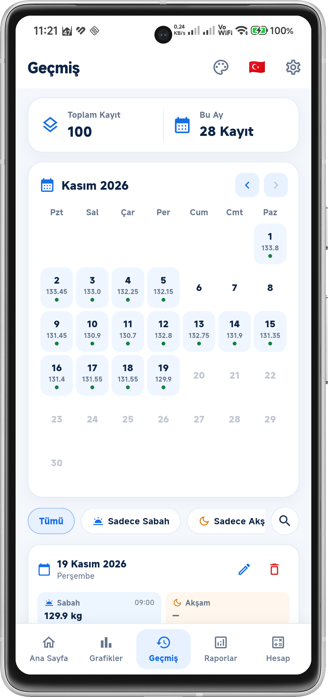
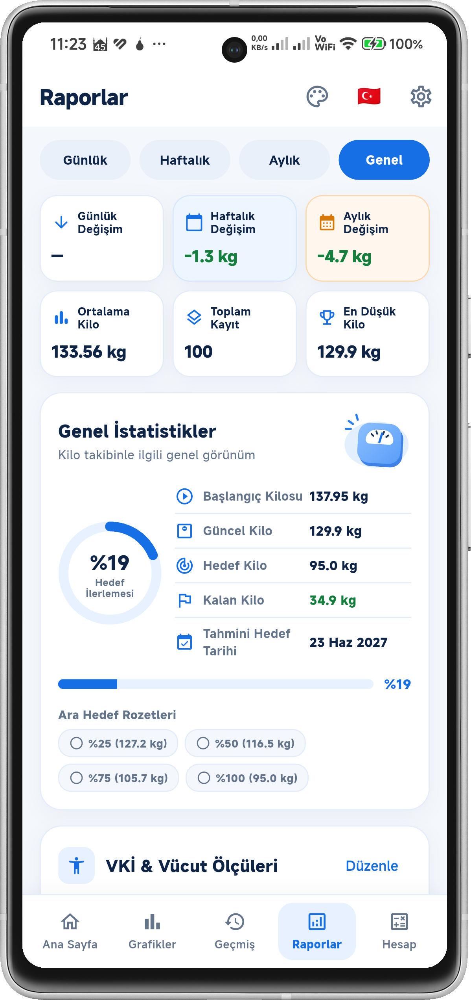
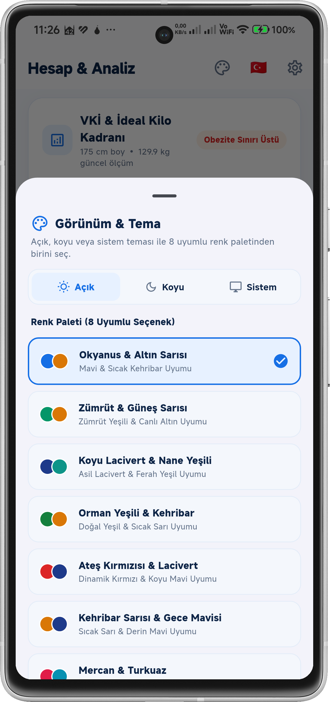
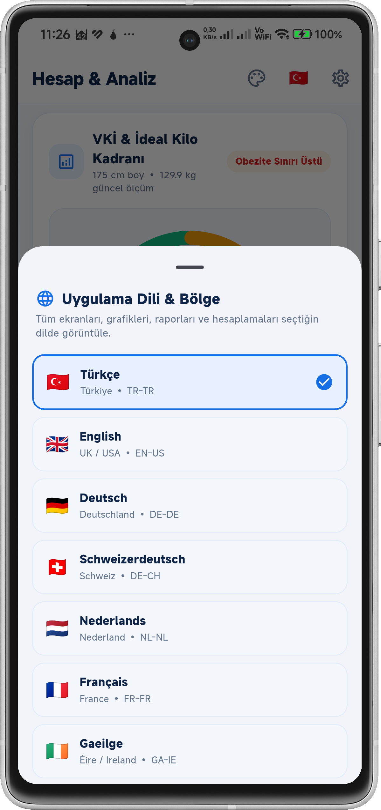
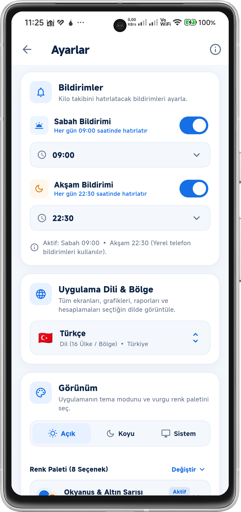

# ⚖️ Kilo & Bel Takip (Weight & Waist Tracker)

<p align="center">
  
</p>

<p align="center">
  <b>Kişisel hedeflerinize ulaşmanız için tasarlanmış modern, %100 çevrimdışı, gizlilik odaklı ve eksiksiz kilo ve vücut ölçümü takip uygulaması.</b>
</p>

<p align="center">
  <a href="https://github.com/mehmet-karataslar/kiloTakip/releases/latest"></a>
  <a href="https://flutter.dev"></a>
  <a href="https://dart.dev"></a>
  <a href="#"></a>
  <a href="#"></a>
  <a href="#"></a>
</p>

---

## 📥 Hazır APK İndir
Uygulamayı hemen Android cihazınıza yüklemek için en güncel kararlı sürümü indirin:
👉 **[Kilo & Bel Takip v1.0.0 APK İndir (GitHub Release)](https://github.com/mehmet-karataslar/kiloTakip/releases/latest/download/app-release.apk)**

---

## 🌟 Öne Çıkan Özellikler

### 1. ⚖️ Kilo & Bel Çevresi Takibi
* **Sabah & Akşam Ayrımı:** Gün içindeki su tutumu ve metabolik dalgalanmaları net gözlemlemek için sabah ve akşam ölçümlerini ayrı ayrı kaydedin.
* **Bel Ölçümü Entegrasyonu:** Yalnızca kilo değil, yağ yakımının en güvenilir göstergesi olan bel çevresi (cm/inç) ölçümlerinizi de kaydedin.
* **Günlük Fark Analitiği:** Bir önceki güne göre kilo ve bel farkını anında renkli göstergelerle görün.
* **Seri & Sadakat (Streak):** Düzenli tartılma alışkanlığı kazandıran motivasyon serisi sayacı.

### 2. 📊 İnteraktif Grafikler & Karşılaştırmalar
* **Dinamik Eğri Grafikleri:** Seçtiğiniz tarih aralığına göre (7 Gün, 30 Gün, 90 Gün, 1 Yıl, Tümü) kilonuzun seyrini izleyin.
* **Sabah / Akşam Çift Sütun Grafiği:** Günün iki farklı vaktindeki dalgalanmaları yan yana karşılaştırın.
* **Hedef Kilo Çizgisi:** Hedefinize ne kadar yaklaştığınızı grafik üzerinde referans çizgisiyle görün.

### 3. 🧠 Kapsamlı Vücut Analizleri & Hesaplayıcılar
* **VKİ (Vücut Kitle İndeksi):** DSÖ standartlarında kategori ve sağlıklı aralık gösterimi.
* **İdeal Kilo Hesaplama:** Bilimsel formüllerle (Devine, Robinson, Hamwi) vücut yapınıza en uygun kilo aralığı.
* **Vücut Yağ Oranı (BFP):** ABD Donanması (U.S. Navy) formülüyle boy, kilo ve bel çevresi üzerinden tahmini yağ oranı.
* **BMR & TDEE:** Bazal Metabolizma Hızı ve günlük aktivite seviyenize göre yakılan kalori tahmini.
* **Makro Besin Planlayıcı:** Kilo verme, koruma veya kas kazanma hedefinize göre günlük Protein, Karbonhidrat ve Yağ ihtiyacı gramajları.
* **Hedef Projeksiyonu:** Mevcut ilerleme hızınıza göre hedef kilonuza ulaşacağınız tahmini tarihi hesaplayan simülatör.

### 4. 💧 Akıllı Su Takibi
* Günlük su tüketim hedefinizi belirleyin.
* 250ml ve 500ml hızlı ekleme butonları ile kolayca su tüketiminizi kaydedin ve ilerleme halkasından takip edin.

### 5. 🎨 8 Uyumlu Renk Paleti & Modern Temalar
* Göz yormayan, birbiriyle uyumlu profesyonel renk paletleri:
  * 🌿 **Zümrüt Yeşili (Emerald)**
  * 🌌 **Gece Yarısı Mavisi (Midnight Blue)**
  * 🌊 **Okyanus Ferahlığı (Ocean Teal)**
  * 🌅 **Gün Batımı Turuncusu (Sunset Orange)**
  * 🔘 **Antrasit & Çelik (Anthracite)**
  * 🌳 **Orman Yeşili (Forest Green)**
  * 💎 **Safir & Kobalt (Cobalt Sapphire)**
  * 🍁 **Sonbahar & Bakır (Autumn Amber)**
* **Karanlık (Amoled/Dark), Aydınlık (Light) ve Sistem Teması** tam uyumluluğu.

### 6. 🌍 16 Uluslararası Dil Desteği
* Uygulama içi tek tıkla dil değişimi:
  * 🇹🇷 Türkçe, 🇬🇧 English, 🇩🇪 Deutsch, 🇪🇸 Español, 🇫🇷 Français, 🇮🇹 Italiano, 🇷🇺 Русский, 🇸🇦 العربية, 🇨🇳 中文, 🇯🇵 日本語, 🇰🇷 한국어, 🇮🇳 हिन्दी, 🇵🇹 Português, 🇳🇱 Nederlands, 🇵🇱 Polski, 🇺🇦 Українська.

### 7. 🔒 %100 Çevrimdışı Güvenlik & Excel Dışa Aktarma
* **Sıfır Bulut Bağımlılığı:** Verileriniz asla bir üçüncü parti sunucuya gönderilmez; tamamen cihazınızdaki yerel SQLite veritabanında saklanır.
* **Excel (.xlsx) Raporlama:** Tüm tartı geçmişinizi, bel ölçümlerinizi, saatlerini ve notlarınızı Excel formatında tek tıkla dışa aktarın veya paylaşın.
* **Özelleştirilebilir Bildirimler:** Sabah ve akşam tartılma saatleriniz için ayrı ayrı ayarlanabilen yerel bildirim altyapısı.

---

## 📱 Ekran Görüntüleri ve Uygulama Akışı

| 01. Gösterge Paneli | 02. Kilo & Bel Ekleme | 03. Grafikler & Kıyas |
|:---:|:---:|:---:|
|  |  |  |
| *Günlük özet, farklar, su takibi ve mini grafik* | *Sabah/akşam, bel ölçüsü, etiketler ve notlar* | *Trend eğrisi ve sabah-akşam sütun grafikleri* |

| 04. Geçmiş & Takvim | 05. Hedef & Raporlar | 06. Hesap & Analizler |
|:---:|:---:|:---:|
|  |  |  |
| *Tüm kayıtlar, bel rozetleri ve düzenleme* | *Hedef tamamlama halkası ve haftalık istatistikler* | *VKİ, yağ oranı, BMR/TDEE ve makrolar* |

| 07. Tema & Renk Paleti | 08. Çoklu Dil Desteği | 09. Ayarlar & Yedekleme |
|:---:|:---:|:---:|
|  |  |  |
| *8 uyumlu renk paleti ve açık/koyu mod* | *16 uluslararası dil ve bayrak seçimi* | *Çift hatırlatıcı ve Excel dışa aktarma* |

---

## 🏗️ Mimari ve Proje Yapısı

Uygulama, **Clean Architecture** prensiplerine uygun, sürdürülebilir ve test edilebilir katmanlı mimari ile geliştirilmiştir:

```text
lib/
├── core/
│   ├── l10n/              # 16 dilin yerelleştirme dosyaları ve çeviri anahtarları
│   ├── theme/             # 8 uyumlu renk paleti ve dinamik ThemeData üreticileri
│   └── constants/         # Sabitler ve yardımcı fonksiyonlar
├── data/
│   ├── local/             # SQLite veritabanı kurulumu (database_helper.dart)
│   ├── models/            # WeightEntry, UserGoal, WaterEntry veri modelleri
│   └── repositories/      # Veri erişim katmanı implementasyonları
├── domain/
│   ├── calculations/      # VKİ, Yağ Oranı, BMR, TDEE ve Makro hesap motoru
│   └── usecases/          # İş mantığı ve veri işleme fonksiyonları
└── presentation/
    ├── dashboard/         # Ana gösterge paneli ve özet kartları
    ├── editor/            # Kilo ve bel ölçüsü ekleme alt sayfası (BottomSheet)
    ├── charts/            # fl_chart tabanlı çizgi ve çift sütun grafikleri
    ├── history/           # Geçmiş kayıt listesi ve takvim bileşeni
    ├── reports/           # Detaylı istatistik ve hedef analiz ekranı
    ├── calculator/        # Vücut kitle, kalori ve yağ oranı hesaplama aracı
    ├── theme/             # Tema ve renk paleti seçici modal
    └── settings/          # Ayarlar, hatırlatıcılar ve Excel export sayfası
```

---

## 🛠️ Kullanılan Teknolojiler & Kütüphaneler

* **Framework:** [Flutter](https://flutter.dev) (Dart 3.x)
* **Yerel Veritabanı:** [`sqflite`](https://pub.dev/packages/sqflite) & [`path_provider`](https://pub.dev/packages/path_provider)
* **Grafik Motoru:** [`fl_chart`](https://pub.dev/packages/fl_chart)
* **Durum Yönetimi:** [`provider`](https://pub.dev/packages/provider) & `ChangeNotifier`
* **Yerel Bildirimler:** [`flutter_local_notifications`](https://pub.dev/packages/flutter_local_notifications)
* **Dışa Aktarma & Excel:** [`excel`](https://pub.dev/packages/excel) & [`share_plus`](https://pub.dev/packages/share_plus)
* **Tercihler & Depolama:** [`shared_preferences`](https://pub.dev/packages/shared_preferences)

---

## 💻 Geliştirici Kurulumu

Projeyi yerel bilgisayarınızda derleyip çalıştırmak için:

1. **Depoyu klonlayın:**
   ```bash
   git clone https://github.com/mehmet-karataslar/kiloTakip.git
   cd kiloTakip
   ```

2. **Bağımlılıkları yükleyin:**
   ```bash
   flutter pub get
   ```

3. **Uygulamayı çalıştırın (Emülatör veya Fiziksel Cihaz):**
   ```bash
   flutter run
   ```

4. **Release APK Derleme:**
   ```bash
   flutter build apk --release
   ```
   *Oluşan dosya: `build/app/outputs/flutter-apk/app-release.apk`*

---

## 📄 Lisans
Bu proje kişisel sağlık ve fitness takibi amacıyla geliştirilmiştir. Tüm hakları saklıdır.
